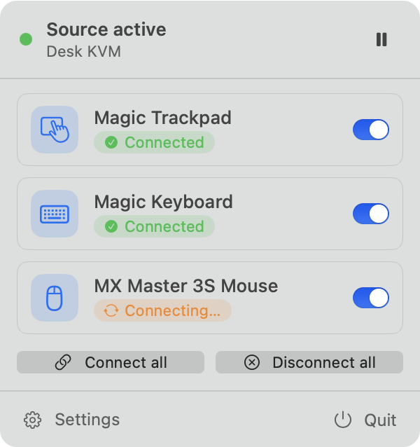
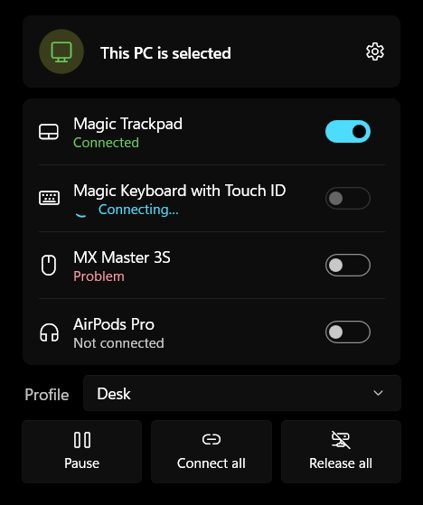

# AutoSwitch KVM

**Your Bluetooth keyboard, mouse and trackpad follow your KVM switch.**

Press the button on your KVM and the other computer gets your monitor, your USB devices *and*
your Bluetooth keyboard, mouse or trackpad. No trip to Bluetooth settings, no re-pairing by hand,
no channel keys to press.

AutoSwitch KVM is a small app that runs in the background on each of your computers (a menu bar
app on macOS, a tray app on Windows). It notices when the KVM switches to or away from that
computer and moves your Bluetooth devices along with it:

- **Apple Magic Trackpad, Keyboard and Mouse:** it hands the pairing over to the other computer.
- **Logitech Easy-Switch keyboards and mice** (e.g. K380): it tells the device to switch to the
  other computer's channel.
- **Everything else:** it tells you what's possible for the device and shows its status (see
  [which devices can follow the KVM](#which-bluetooth-devices-can-follow-the-kvm)).

<p align="center">
  
  &nbsp;&nbsp;
  
</p>
<p align="center"><sub>The menu bar panel on macOS (left) and the tray panel on Windows (right).</sub></p>

## The problem it solves

A KVM switch shares one desk (monitor, keyboard, mouse) between two computers. That works for
wired and USB devices, because they're plugged into the KVM. **Bluetooth devices aren't**: they
stay connected to whichever computer they last paired with.

So every switch means some manual work, depending on the device:

- **One-computer devices** like Apple's **Magic Trackpad** can only be paired with one computer
  at a time. Moving one means removing it in the first computer's Bluetooth settings, then
  searching and pairing on the other. Switch back later? All again, the other way.
- **Multi-channel devices** like Logitech's **Easy-Switch** keyboards and mice remember a
  channel per computer, but you press the channel key on every device, every time you switch.

AutoSwitch KVM does that work for you every time the KVM switches.

## What you get

- **Hands-off switching.** Devices connect when your computer is selected and are released when
  it isn't. Nothing to click.
- **Works with one-computer devices.** It unpairs on the way out and pairs on the way in, so the
  Magic Trackpad, Keyboard and Mouse hand over cleanly.
- **Speaks Logitech Easy-Switch.** It tells the device to change channel, finds the other
  computer's channel by itself, and shows which computer is on which channel.
- **Knows your devices.** Settings shows how each device handles a second computer and whether
  AutoSwitch can switch it, and suggests the fix when it can't.
- **Several devices.** Keyboard, mouse, trackpad: choose which follow the KVM and in what order.
- **Easy setup.** Switch the KVM once and the app learns which USB device tells it which computer
  is selected.
- **Profiles.** Keep separate setups, for example "Desk" and "Travel", and switch between them.
- **Stays out of the way.** Pause automation any time, use Connect all / Release all, or set
  keyboard shortcuts. It releases devices when the computer goes to sleep and catches up when it
  wakes.
- **Native on each platform**, with automatic updates.

## Download

| | Platform | Get it | Status |
|---|---|---|---|
| 🍎 | **macOS** 13 Ventura or later, Apple silicon or Intel | `AutoSwitchKVM-<version>-macos.dmg` from [Releases](https://github.com/casab/AutoSwitchKVM/releases) | Stable |
| 🪟 | **Windows** 10 (1809) or 11, x64 or ARM64 | `AutoSwitchKVM.App-win-Setup.exe` (or `-win-arm64-Setup.exe`) from [Releases](https://github.com/casab/AutoSwitchKVM/releases) | Beta |

The builds aren't signed with a paid developer certificate yet, so the first launch shows a
warning:

- **macOS:** after the first open is blocked, go to **System Settings ▸ Privacy & Security** and
  click **Open Anyway**. Then allow Bluetooth when the app asks; it can't move your devices
  without it. For a Logitech Easy-Switch device it also asks once for **Input Monitoring**.
- **Windows:** on the SmartScreen prompt, click **More info ▸ Run anyway**.

## Getting started

1. **Install the app on both computers** connected to the KVM. Each one releases the devices when
   the KVM switches away from it, so the other computer can pick them up.
2. **Teach it your KVM.** In Settings, choose *Learn* for the KVM source, then switch the KVM to
   the other computer and back. The app spots the USB device that comes and goes with the switch.
3. **Add your Bluetooth devices.** AutoSwitch shows how each one switches and sets **Manage
   pairing** to match: on for a Magic Trackpad (or anything that only pairs with one computer at
   a time), off for a Logitech Easy-Switch device, which changes channel instead.
4. **Switch the KVM.** Your devices follow, usually within a few seconds.

Platform guides with more detail: [Windows](windows/README.md) · [macOS](osx/README.md).

## Which Bluetooth devices can follow the KVM?

Not every Bluetooth device can be moved by an app. It depends on how the device handles more
than one computer, and there are four kinds. AutoSwitch tells you which kind a device is when
you add it, and what it can do with it.

| Kind | How the device behaves | Examples | Can AutoSwitch switch it? |
|---|---|---|---|
| **Hands off by pairing** | Holds one pairing. Once a computer lets go, the next one can pair without you touching the device. | Apple Magic Trackpad, Magic Keyboard, Magic Mouse | **Yes**, on Mac and Windows. This is what AutoSwitch was built for. |
| **Picks the computer itself** | Remembers several computers, and a key on the device chooses one. | ZMK and QMK wireless keyboards | **No.** Only the device can choose. Use its switch key, or plug it into the KVM by USB. |
| **Re-pairs by hand** | Remembers one Bluetooth computer. Moving it needs its pairing button. | Xbox, PlayStation and Nintendo controllers | **No.** Keep it on one computer, connect it by cable through the KVM, or pair it to a Bluetooth-to-USB adapter (e.g. 8BitDo USB Wireless Adapter 2) plugged into the KVM. |
| **Switches channel on request** | Like the previous kind, but the computer it's connected to can tell it to change channel. | Logitech Easy-Switch keyboards and mice (e.g. K380) | **Yes**, on Mac and Windows: when the KVM leaves, AutoSwitch sends it to the other computer's channel. |
| **Joins whichever computer connects** | Remembers several computers and goes to the one that asks. | Many headphones and speakers | **On Mac, yes** (being tested). On Windows not yet: Windows can't disconnect a Bluetooth device without unpairing it. |

**Using a USB receiver?** Logitech Unifying, Logi Bolt and Lightspeed receivers are faster than
Bluetooth, and they need no software to follow the KVM: plug the receiver into the KVM's USB hub,
and it switches like a wired keyboard. Use the KVM's plain USB (hub) port, not a
"keyboard/mouse emulation" port, which often doesn't pass receivers through properly.

For the kinds it can't switch, AutoSwitch still shows whether the device is connected. Not sure
about a device? Remove it in one computer's Bluetooth settings. If the other computer can then
pair it right away, without a button press on the device, it hands off by pairing.
More detail: [autoswitchkvm.com/devices](https://autoswitchkvm.com/devices/).

## Good to know

- **Which devices work?** Apple Magic accessories (they hand off by pairing) and Logitech
  Easy-Switch keyboards and mice (they switch channel), on both platforms. The table above covers
  the rest, and Settings tells you for each device.
- **Which KVMs work?** Any KVM that switches USB between the computers. Most do, because that's
  how they share your keyboard and mouse.
- **Why a few seconds?** The computer the KVM switched to has to wait until the other one lets go
  of the device before it can pair. AutoSwitch retries quietly until that happens.
- **Your settings stay put.** Each computer keeps its own settings. You can export and import
  them as a file.
- **Updates install themselves.** Both apps check GitHub for new versions and offer them, so you
  install once and stay current.
- **Private by design.** Everything happens on your computers. The only network request is the
  update check.
- **Something not working?** Each platform guide has a troubleshooting section. For a bug
  report, set **Settings ▸ Diagnostics ▸ Log detail** to **Detailed**, reproduce the problem, and
  attach that day's log. At the default level the log stays small: a few lines per switch.

---

## For developers

AutoSwitch KVM is a monorepo with one **native app per platform**. Both apps share the same
behavior and settings model, but each uses its own platform's toolkit and Bluetooth/USB APIs.

| Platform | Folder | Stack |
|---|---|---|
| macOS | [`osx/`](osx/) | Swift / SwiftUI menu bar app, IOKit (USB) + IOBluetooth, Sparkle updates |
| Windows | [`windows/`](windows/) | C# / .NET 8 + WinUI 3 tray app, WMI/PnP (USB) + WinRT Bluetooth, Velopack updates |
| Linux | n/a | Future, not a current focus |

**How it works:** watch USB attach/detach for the configured *source* (a set of USB device IDs,
usually a hub inside the KVM). After a short debounce, when the source appears connect the
configured devices (pairing first if *Manage pairing* is on). When it disappears, release them
(unpair for one-host devices). Failures are classified: "the other computer still has it" is
retried patiently, a stale pairing is redone from scratch. The full platform-neutral behavior
contract is in [`SPECIFICATION.md`](SPECIFICATION.md).

```
osx/              macOS app: sources, tests, docs (README, CLAUDE, PLAN, IMPROVEMENTS)
windows/          Windows app: sources, tests, tools, docs (README, CLAUDE, PLAN)
SPECIFICATION.md  Behavior contract both apps implement (config model, engine, Bluetooth ops)
testdata/         Shared config fixture; both test suites read it, so settings stay compatible
agent-notes/      Coordination notes between the macOS and Windows work streams
website/          autoswitchkvm.com (Eleventy, deployed on Cloudflare Workers)
.github/          CI (build + tests for both apps) and release workflows
```

**Releases:** pushing a tag `vX.Y.Z` builds both apps and publishes one GitHub release with the
Windows installers and the macOS DMG. Installed apps update from the latest stable release. A
pre-release tag (`vX.Y.Z-beta.1`) is never offered as an update.

Build instructions, architecture and troubleshooting notes are in each platform folder:
[`windows/README.md`](windows/README.md), [`osx/README.md`](osx/README.md).
