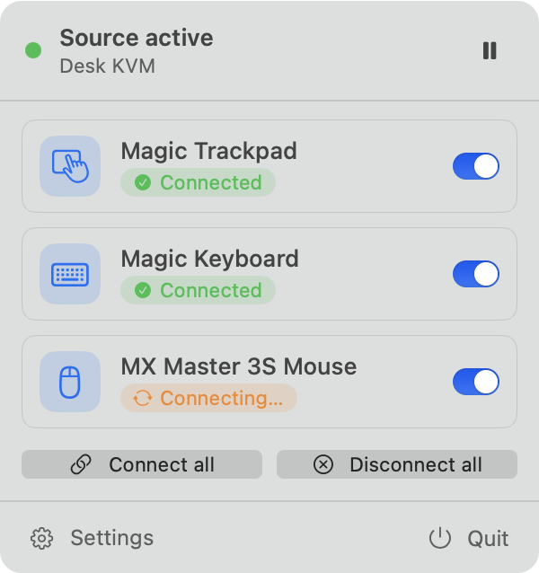
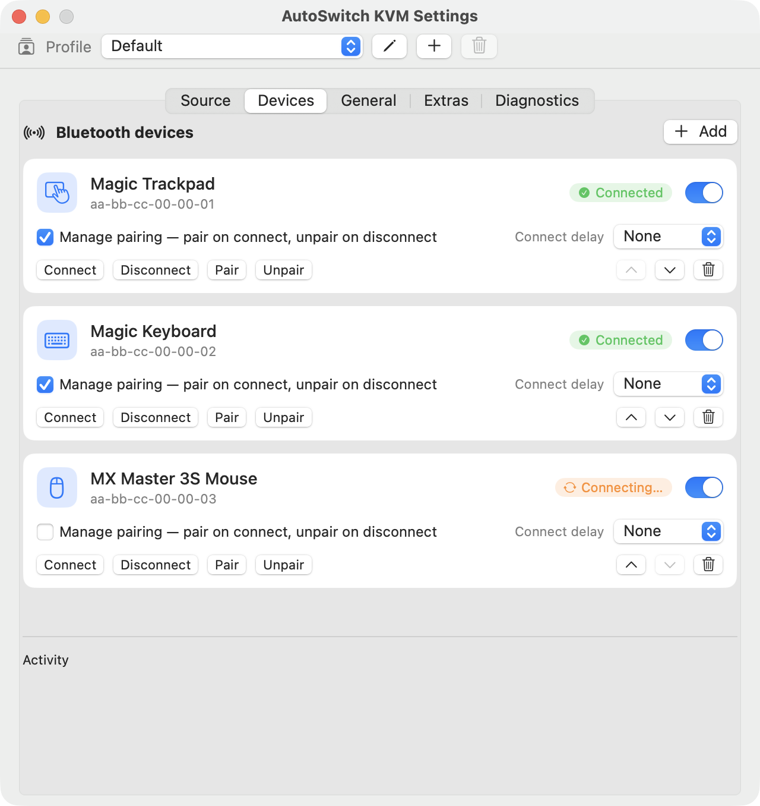

# AutoSwitch KVM for macOS

**Your Bluetooth trackpad and keyboard follow your KVM switch to this Mac, and leave with it.**

AutoSwitch KVM lives in the menu bar. When your KVM switches to this Mac it connects your Bluetooth
devices, pairing them first if needed. When the KVM switches away it releases them, so your other
computer can take over. It's the Mac half of a pair: the [Windows app](../windows/README.md) does
the same on your PC. See the [project overview](../README.md) for the bigger picture.

<p align="center">
  
</p>

> **Status: stable.** Used every day to move an Apple Magic Trackpad between a Mac and a Windows
> PC. Bug reports and ideas are welcome on
> [GitHub Issues](https://github.com/casab/AutoSwitchKVM/issues).

## Install

1. Download **`AutoSwitchKVM-<version>-macos.dmg`** from the latest
   [release](https://github.com/casab/AutoSwitchKVM/releases) and drag **AutoSwitch KVM** into
   **Applications**. One download covers Apple silicon and Intel Macs.
2. Open it. The app isn't notarized by Apple yet, so macOS blocks the first open: go to
   **System Settings ▸ Privacy & Security** and click **Open Anyway**. You only do this once.
3. When macOS asks whether AutoSwitch KVM may use **Bluetooth**, click **Allow**. It can't move
   your devices without it.

Requirements: macOS 13 Ventura or later, with Bluetooth.

**Updates are automatic.** The app checks once a day and offers new versions itself. To check
now, or to turn the daily check off, open **Settings ▸ General ▸ Updates**.

## Set up (about two minutes)

Click the AutoSwitch KVM icon in the menu bar and choose **Settings**.

1. **Teach it your KVM.** In the **Source** tab, click **Learn source…**, then switch your KVM to
   the other computer and back. AutoSwitch shows the USB devices that came and went (usually hubs
   inside the KVM). Keep those, untick anything else, give the source a name such as "Desk KVM",
   and save. You can also pick the devices yourself with **Pick manually…**.
2. **Add your devices.** In the **Devices** tab, click **Add** and pick your trackpad, keyboard or
   mouse from the devices this Mac knows. For the **Magic Trackpad**, or any device that only
   pairs with one computer at a time, turn on **Manage pairing**.
   For a **Logitech Easy-Switch** keyboard or mouse (e.g. K380), leave Manage pairing **off**:
   AutoSwitch tells it to change channel instead. Its card then shows "Switches channel on
   request" and which channel this Mac is on. The other computer's channel is found
   automatically; you can also set it there. macOS asks once for the **Input Monitoring**
   permission, which AutoSwitch needs to talk to the keyboard.
3. **Install it on your other computer too** and set it up the same way, so that computer
   releases the devices when the KVM leaves it.

That's it. Switch the KVM and your devices follow, usually within a few seconds.

<p align="center">
  
</p>

## Everyday use

Click the menu bar icon for a quick look:

- **What's happening:** whether the KVM is on this Mac ("Source active"), plus each device's
  state: Connected, Connecting…, Disconnected, or Error (Settings shows the reason at the top).
- **A switch per device**, to leave a device out of the automatic handoff for a while.
- **Pause** automation, or **Connect all** / **Disconnect all** by hand.
- **Profiles**, when you have more than one.

The icon itself changes when the KVM is on this Mac, when it's elsewhere, when you've paused, and
when Bluetooth is off.

Also in Settings:

- **Profiles:** separate setups (a KVM source plus its devices), e.g. "Desk" and "Travel". Switch
  between them from the bar at the top of Settings or from the menu bar.
- **Device order and delay:** devices connect top to bottom; a per-device delay can stagger them.
- **Keyboard shortcuts** (General): optional system-wide shortcuts to pause, connect all and
  disconnect all. The defaults are ⌃⌥⌘P / ⌃⌥⌘C / ⌃⌥⌘D, and you can record your own.
- **Launch at login**, **notifications**, and automatic **reconnect** when a device drops.
- **Back up or restore** all your settings as a file (General ▸ Configuration).
- **Extras:** hide the Dock automatically when the Mac is on its built-in display only.

AutoSwitch also releases your devices when the Mac goes to sleep, and catches up when it wakes.

## Troubleshooting

- **A device takes a few seconds to connect after a switch.** That's usually the other computer
  still holding it; AutoSwitch keeps retrying until it lets go. If it never arrives, check that
  AutoSwitch is running on the other computer too.
- **The trackpad says it's stuck** ("paired but never started its HID connection"). Switch the KVM
  to the other computer and back, or turn the trackpad off and on.
- **The Mac thinks the KVM is here when it isn't.** Some docks contain the same USB hubs as the
  KVM. Run **Learn source…** again: it pins the source to the KVM's own port.
- **A Logitech keyboard doesn't change channel.** Check **System Settings ▸ Privacy & Security ▸
  Input Monitoring** and make sure AutoSwitch KVM is allowed, and that Manage pairing is off for it.
  It also needs AutoSwitch on the other computer to send it back.
- **Nothing happens at all.** Check **System Settings ▸ Privacy & Security ▸ Bluetooth** and make
  sure AutoSwitch KVM is allowed.
- **"AutoSwitch KVM is already running."** Only one copy can manage your devices at a time; use
  the one in the menu bar.
- **Reporting a bug.** In **Settings ▸ Diagnostics**, set **Log detail** to **Detailed**,
  reproduce the problem, then click **Show Log Files** and attach that day's log. At the default
  level the log stays small: a few lines per switch.

**Privacy:** everything happens on your Mac. The only network request is the update check to
GitHub. Settings are in `~/Library/Application Support/AutoSwitchKVM`, logs in
`~/Library/Logs/AutoSwitchKVM` (kept for 14 days).

**Uninstall:** quit the app from its menu, then drag it from Applications to the Trash. Delete the
two folders above too if you don't plan to reinstall.

---

## For developers

### Build and run

Requirements: **Xcode 16 or later** (the code needs the Swift 6 toolchain). The app targets
macOS 13+. Run the commands from this folder (`osx/`).

- **Quick loop (Swift Package):** open `Package.swift` in Xcode, choose the **AutoSwitchKVM**
  scheme and **My Mac**, and run. Or `swift build` from the terminal.
- **The real `.app`:** `brew install xcodegen` once, then `xcodegen generate` and open
  `AutoSwitchKVM.xcodeproj`. Use this for anything that needs a bundle: notifications, launch at
  login, and automatic updates.
- **Tests:** `swift test` (or ⌘U). The engine is tested against fake USB and Bluetooth, so no
  hardware is needed. CI runs build, tests and a blocking `swift-format` lint on every push.
- **Only one copy runs.** Quit the installed app before running a dev build; the dev build would
  otherwise say it's already running.
- Local builds are self-signed, so macOS may ask for the Bluetooth permission again after a
  rebuild.

### How it's built

A single SwiftUI menu bar target, organized by folder under `Sources/AutoSwitchKVM/`:

- **`Engine/`**: `SelectionEngine`, the switching state machine. It debounces USB changes,
  connects or releases devices in *runs* that a newer switch can cancel, retries with failure
  classification (the other computer still holding the device is retried patiently; a stale
  pairing is redone), and releases devices before sleep.
- **`USB/`**: IOKit attach/detach monitoring with a periodic reconcile, and the source learner.
  Sources are matched by USB IDs and bus location, so identical hubs elsewhere don't count.
- **`Bluetooth/`**: IOBluetooth pairing, connecting and unpairing, with every result code
  decoded. Unpairing uses `-[IOBluetoothDevice remove]` (there's no public API; `blueutil` uses
  the same call). A device counts as connected only once its HID connection is up.
- **`Models/`**, **`System/`**, **`Support/`**, **`UI/`**: settings and profiles stored as JSON,
  sleep/wake, login item, shortcuts, notifications, single-instance lock, logging (with a
  user-set log level), and the menu bar panel and Settings window. `App/` wires it together and
  holds the Sparkle updater.

The behavior both platforms implement is specified in [`../SPECIFICATION.md`](../SPECIFICATION.md).
[`CLAUDE.md`](CLAUDE.md) has the detailed engineering notes and the hardware lessons behind them,
[`PLAN.md`](PLAN.md) the original design, and [`IMPROVEMENTS.md`](IMPROVEMENTS.md) the roadmap.
`reference/hammerspoon_init.lua` is the prototype the app grew from.

### Logs while developing

Besides the daily file, the app logs through `os.Logger` (subsystem `com.enginal.AutoSwitchKVM`,
categories `app`, `usb`, `bluetooth`, `engine`):

```sh
log stream --predicate 'subsystem == "com.enginal.AutoSwitchKVM"'
```

For a handoff that went wrong, macOS's own Bluetooth log usually shows why:
`/usr/bin/log show --predicate 'process == "bluetoothd"' --last 10m`.

### Releasing

Push a version tag. Together with the Windows build, the **macOS release** workflow builds a
universal app, signs it, packs the DMG, and attaches it to the same GitHub release, along with the
signed update feed (`appcast.xml`) that installed copies check:

```sh
git tag v0.2.0 && git push origin v0.2.0
```

A pre-release tag (`v0.2.0-beta.1`) is never offered as an update. To build a DMG locally:
`tools/release.sh 0.2.0` (output in `build/release/`). The workflow needs the repository secrets
`SPARKLE_ED_PRIVATE_KEY` (signs updates) and, optionally, `MACOS_SIGNING_P12` +
`MACOS_SIGNING_P12_PASSWORD` (a fixed signing certificate, so the Bluetooth permission survives
updates). With an Apple Developer ID, notarization would slot into the same script.
