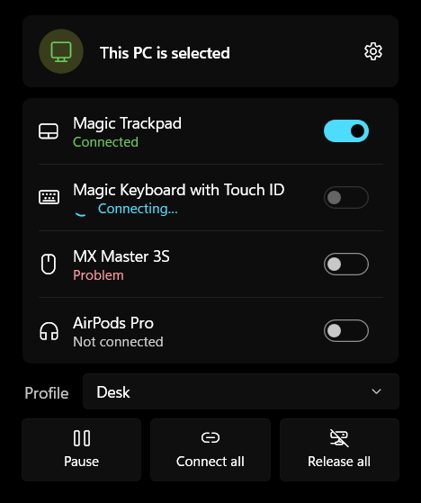
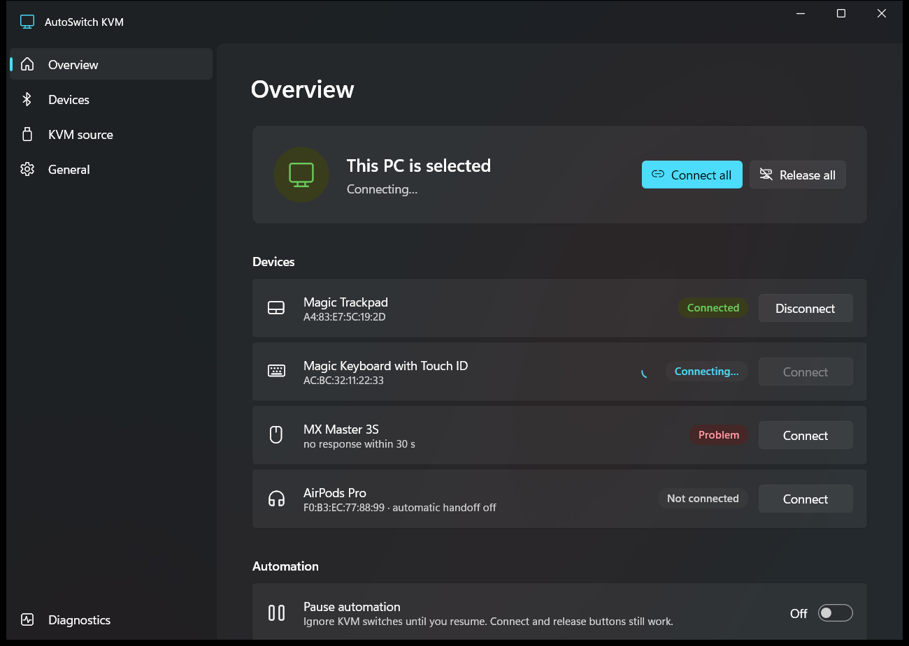

# AutoSwitch KVM for Windows

**Your Bluetooth trackpad and keyboard follow your KVM switch to this PC, and leave with it.**

AutoSwitch KVM sits in the system tray. When your KVM switches to this PC it connects your
Bluetooth devices, pairing them first if needed. When the KVM switches away it releases them, so
your other computer can take over. It's the Windows half of a pair: the
[macOS app](../osx/README.md) does the same on your Mac. See the [project overview](../README.md)
for the bigger picture.

<p align="center">
  
</p>

> **Status: beta.** Used daily on real hardware (Apple Magic Trackpad between a Windows 11 PC and
> a Mac). Feedback and bug reports are welcome on
> [GitHub Issues](https://github.com/casab/AutoSwitchKVM/issues).

## Install

1. Download **`AutoSwitchKVM.App-win-Setup.exe`** from the latest
   [release](https://github.com/casab/AutoSwitchKVM/releases). On an ARM PC (e.g. Snapdragon),
   take `AutoSwitchKVM.App-win-arm64-Setup.exe`.
2. Run it. If SmartScreen says "Windows protected your PC", click **More info ▸ Run anyway**. The
   app isn't code-signed yet.
3. It installs for your user account only (no admin needed), starts, and opens Settings.

Requirements: Windows 10 version 1809 or later, or Windows 11, with Bluetooth. Nothing else to
install; everything the app needs is included.

**Updates are automatic.** The app checks in the background and offers **Restart to update**
when a new version is ready (in the tray menu, as a notification, and in
**Settings ▸ General ▸ About**).

## Set up (about two minutes)

1. **KVM source.** Open **Settings ▸ KVM source** and choose **Learn from a switch**. Switch your
   KVM to the other computer and back. AutoSwitch finds the USB device that comes and goes with
   the switch (usually a hub inside the KVM). You can also pick it from a list or type its IDs.
2. **Devices.** In **Settings ▸ Devices**, choose **Add device** and pick your trackpad, keyboard
   or mouse. For the **Magic Trackpad**, or any device that only pairs with one computer at a
   time, keep **Manage pairing** on.
3. **Do the same on your other computer**, so it releases the devices when the KVM leaves it.

That's it. Switch the KVM and your devices follow, usually within a few seconds.

<p align="center">
  
</p>

## Everyday use

- **Click the tray icon** for the quick panel: what's connected, a switch per device, the active
  profile, and **Pause**, **Connect all** and **Release all**.
- **Right-click** for the menu: the same actions, profiles, Settings and Exit.
- **Double-click** to open Settings.
- **The icon shows the state:** this PC selected, another computer selected, paused, or Bluetooth
  off.

Also in Settings:

- **Profiles:** separate setups (a source plus its devices), e.g. "Desk" and "Travel".
- **Keyboard shortcuts:** optional global shortcuts to pause, connect all and release all
  (defaults Ctrl+Alt+P / C / D).
- **Launch at login**, **notifications**, and **timing and retry** options for unusual hardware.
- **Back up or restore** your settings as a file.

AutoSwitch also releases your devices when the PC sleeps, signs out or shuts down, and catches
up when it wakes.

## Troubleshooting

- **A device takes a while to connect after a switch.** That's usually the other computer still
  holding it; AutoSwitch keeps retrying until it lets go. If it never arrives, check that
  AutoSwitch is running on the other computer too.
- **A device shows "Problem".** Use **Connect** on it, or **Settings ▸ Devices ▸ Manual control**
  to pair or unpair it by hand. Turning the device off and on also helps.
- **Reporting a bug.** Set **Settings ▸ Diagnostics ▸ Log detail** to **Detailed**, reproduce the
  problem, then **Open folder** and attach that day's log. Logs and settings live in
  `%LOCALAPPDATA%\AutoSwitchKVM`.

**Uninstall** from Windows Settings ▸ Apps. Your settings and logs are kept, in case you
reinstall.

---

## For developers

### Build and run

Requirements: **.NET 8 SDK** and **Visual Studio 2022** (".NET desktop development" workload with
the Windows App SDK C# templates), on Windows.

- Open `AutoSwitchKVM.sln`, set **AutoSwitchKVM.App** as the startup project, platform **x64**,
  and run. A tray icon appears.
- Command line: `dotnet build src/AutoSwitchKVM.App/AutoSwitchKVM.App.csproj -c Debug -p:Platform=x64`.
- Tests: `dotnet test tests/AutoSwitchKVM.Core.Tests`. The Core library and its tests are plain
  `net8.0`, so they run anywhere, without the Windows SDK.
- UI work without touching your devices: `AutoSwitchKVM.App.exe --ui-preview --settings=overview`
  (Debug builds) runs the UI with no engine and no writes, next to a running copy. Add
  `--config=<file>` and `--preview-demo` for sample data.
- A running copy locks its output folder: exit it first, or build a different configuration.

### How it's built

- **`src/AutoSwitchKVM.Core`**: portable, unit-tested logic with no UI or Windows dependencies.
  It holds the settings model and JSON store, the switching engine (debounce, connect/release
  runs, retries with failure classification), and source learning. Platform services sit behind
  interfaces (`IUsbMonitor`, `IBluetoothController`), so tests use fakes.
- **`src/AutoSwitchKVM.App`**: the WinUI 3 app.
  - `Platform/`: USB detection (WMI/PnP with a periodic reconcile), Bluetooth (WinRT pairing plus
    Win32 `BluetoothRemoveDevice` for a clean release), hotkeys, sleep/wake, launch at login,
    notifications.
  - `Services/`: the `AppController` that wires everything together, and Velopack updates.
  - UI: MVVM `ViewModels/`, the Settings window with its `Views/` pages, and `TrayPanel`.
- **`tests/AutoSwitchKVM.Core.Tests`**: xUnit tests for models, config (including the shared
  golden fixture with macOS), the engine state machine, failure handling and source learning.
- **`tools/`**: `release.ps1` (build an installer), `make-app-icon.py`, and `driver-trace.ps1`
  (Magic Trackpad driver traces).
- **`spikes/`, `reference/`**: the PowerShell hardware experiments and prototype the app grew
  from.

The behavior both platforms implement is specified in [`../SPECIFICATION.md`](../SPECIFICATION.md).
[`PLAN.md`](PLAN.md) has the roadmap, the macOS-to-Windows mapping and size/startup measurements.
[`CLAUDE.md`](CLAUDE.md) has detailed engineering notes and the hardware gotchas learned along
the way.

### Releasing

Push a version tag. The **Windows release** workflow builds x64 and ARM64, packs them with
[Velopack](https://velopack.io) and publishes the GitHub release that installed apps update from:

```sh
git tag v0.2.0 && git push origin v0.2.0
```

A pre-release tag (`v0.2.0-beta.1`) becomes a GitHub pre-release, which installed apps ignore. To
build an installer locally: `pwsh tools/release.ps1 -Version 0.2.0 [-Arch arm64]` (output in
`releases/<arch>/`).
